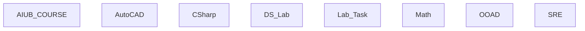

## Stack

Not a code project. No manifest files (package.json, go.mod, pyproject.toml, Cargo.toml) exist at repo root. This is a collection of academic course materials: PDFs, PPTX, DOCX-like slides, images, a CSV, JSON notes, and a handful of standalone Java/C++/AutoCAD source and drawing files (per README.md).

## Directory map

| path | what lives there |
|---|---|
| AIUB_COURSE/ | Offered_Course_Report.csv — course report data |
| AutoCAD/ | .dwg drawing files (1–12) and AUTOCAD OEL.pdf |
| C# / | OOP module PDFs and a midterm note PDF |
| DS Lab/ | Standalone .cpp Data Structures lab programs (linked list, doubly list, ticket mgmt) |
| Lab Task/ | Lab Task 1–5, each with a PDF and standalone .java files (Account, Student, Start) |
| Math/ | Math 2/ (mid-term outline PDF), MATH 6/ (Mid Term subfolder) |
| OOAD/ | OOAD notes, PDFs, and diagram PDFs (use case, class diagram) |
| SRE/ | SRE chapter slides (.pptx), PDFs, JSON notes, quiz images/PDF |
| README.md | Repo overview (see contents) |

## Diagram

No edges: each folder is an independent, self-contained subject archive with no cross-references observed.

## Component index

- [[AIUB_COURSE]]
- [[AutoCAD]]
- [[CSharp]]
- [[DS_Lab]]
- [[Lab_Task]]
- [[Math]]
- [[OOAD]]
- [[SRE]]

## Entry points

- No dev/prod entry point — this is not a runnable project. TODO: verify (no main.*/index.*/app.* files found at repo root or in subfolders read).

## Conventions

- Each top-level folder corresponds to one AIUB course/subject, per README.md's "Overview" list.
- Lab Task subfolders are numbered ("Lab Task 1" … "Lab Task 5"), each pairing a task PDF with matching .java source files.
- DS Lab .cpp files are named descriptively per exercise (e.g. "DS Lab Task 1(Single List).cpp").

## Where things go

- To add a new course/subject, create a new top-level folder named after the subject (matching the pattern of AutoCAD/, C#/, OOAD/, SRE/, etc.) and list it in README.md's Overview.
- To add a new lab task, create a new "Lab Task N" subfolder under `Lab Task/` containing its PDF handout and .java source files.
- To add a new DS Lab exercise, add a descriptively named .cpp file under `DS Lab/`.
- To add new SRE course content, add the file under `SRE/` following the existing chapter-numbered naming (e.g. "SRE - Ch.0N - ...").
